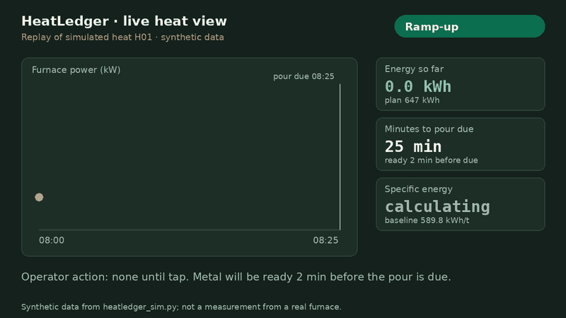
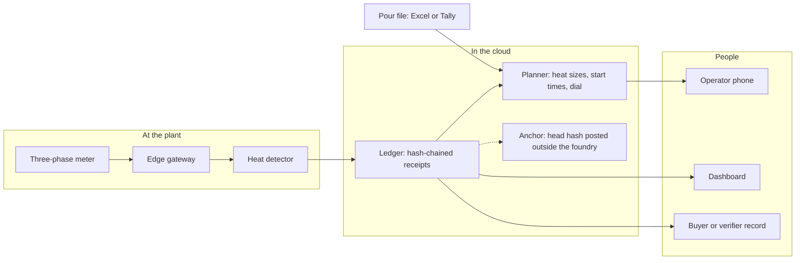

# HeatLedger

**Every heat gets an energy-and-carbon receipt.** A live heat view, a melt planner and a tamper-evident receipt for Indian induction foundries.
Submission to the Yuva Yodha Energy Tech Hackathon 2026, Challenge 04 (Smart Manufacturing).

> **Status: all performance numbers here come from a synthetic simulation.** The operator baseline, grade rules, holding power, per-heat overhead and solar profile are assumptions to be replaced with a plant's own data. Field evidence is summarised at the bottom.



*Replay of simulated heat H01. The MP4 version is `heatledger_live_heat_replay.mp4`.*

## What is in this repository

| Path | What it is |
|---|---|
| `HeatLedger_problem_statement.md` | The full problem statement, with the break-even disclosure |
| `heatledger_sim.py` | Simulator, exact planner, heat detection, calibration, hash-chained receipts, guardrails and solar scenarios |
| `heatledger_results.json` | Every number quoted in the statement and deck |
| `make_replay.py`, `live_heat_H01.json` | Render the replay clip from the simulated heat |
| `charts/` | Daily kWh/t, one-day schedule, shiftable window and sensitivity charts |
| `design/` | Architecture, data schema, manager dashboard, operator screen, receipt and live heat view |

## Architecture



## Data schema

| Table | Key fields |
|---|---|
| `meter_reading` | ts, furnace_id, kw, kvar, pf, thd_pct, seq |
| `pour` | pour_id, due_ts, tonnes, alloy, source_ref |
| `plan` | plan_id, heat_seq, pour_ids, tonnes, start_ts, ready_ts, settings_version |
| `site_settings` | capacity_t, melt_kw, hold_kw, fixed_kwh_per_heat, tariff_slots, grid_ef_kgco2e_per_kwh, grid_ef_source, dial_rs_per_late_min |
| `heat` | heat_id, start_ts, melt_end_ts, tap_ts, tonnes_tapped, melt_kwh, hold_kwh, aux_kw_removed, kwh_per_t, rs_per_t, kgco2e_per_t, prev_hash, hash |
| `batch_record` | batch_id, heat_ids, product_code, kwh_total, kgco2e_total, anchor_id |
| `anchor` | anchor_id, posted_ts, head_hash, heat_count, channel |

## Key results (synthetic, 90 calendar days = 78 working days, seed 1)

| Metric | Operator habit | Planned |
|---|---|---|
| Specific energy, kWh/t | 589.8 | 575.7 |
| Holding, hours per day | 4.0 | 1.2 |
| Late pours, minutes per day | 36.2 | 9.3 |
| Grid emissions, kgCO2e/t (0.710 tCO2/MWh, CEA FY 2024-25, provisional) | 418.8 | 408.7 |

Energy saving: 14.2 kWh/t (2.4%); 15.0 +/- 0.6 over 7 seeds; 15.5 with grade rules (4 seeds). Receipt accuracy on simulated curves: mean energy error 1.7%, 95th percentile 5.2%, worst heat 13.6% (100 kW holding); the 50 kW case is 16.6% worst.

**Where scheduling does not pay:** at 50 kW holding the planner saves energy only when per-heat overhead is below roughly 50 kWh; the sensitivity grid goes to -6.5 kWh/t. See section 7 of the problem statement.

**With contracted solar** (grid kgCO2e/t, baseline schedule / solar-aware planner): 150 kW 382.0 / 381.6; 300 kW 360.0 / 359.1; 600 kW 320.9 / 315.3. The cut comes from the solar supply, not from scheduling.

## Run it

```
pip install numpy matplotlib pillow imageio-ffmpeg
python heatledger_sim.py     # several minutes; rewrites heatledger_results.json and charts/
python make_replay.py        # renders the replay clip from live_heat_H01.json
```

## Field evidence (foundry-reported, anonymised, unaudited)

One plant, 14 heats. A 500 kg induction foundry reports 12-14 heats a day and 600-700 kWh/t; its shift log of 14 consecutive heats averages 663 kWh/t (range 610-782). Notes from five buyer and compliance conversations all wanted heat- or batch-level energy and carbon data; four named a modest premium in mixed units. The raw notes are withheld to protect the foundry's anonymity, and the log does not validate the simulator.

## Hardware (public list prices, excluding taxes, not quotes)

Three-phase Modbus meters about INR 2,025-7,000; split-core CTs INR 800-3,200 each; basic 4G Modbus gateways INR 4,000-7,850. Enclosure, cabling and installation are unquoted. CT ratio must be checked against the furnace feeder current.

## Limits

Results are synthetic. Quality is covered for grade mixing and holding time only. CBAM scope for specific castings is unconfirmed. The receipt is data for a verifier, not a verified report.
